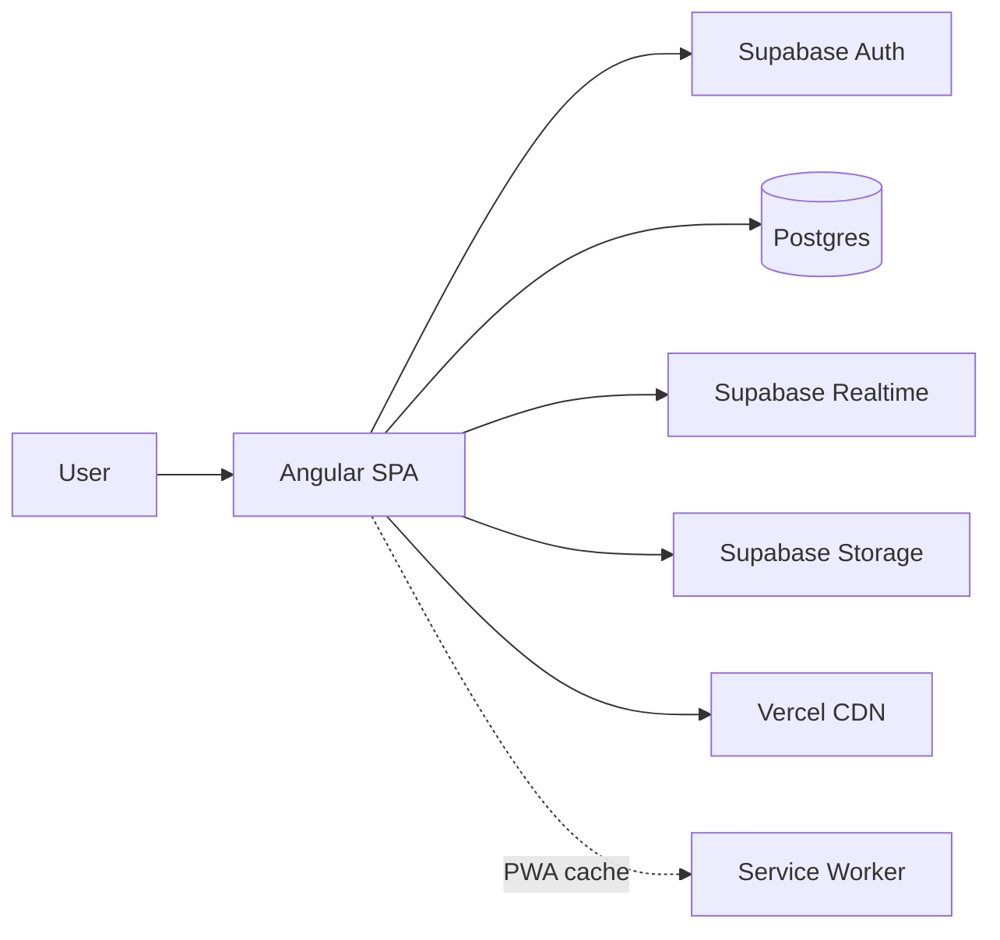
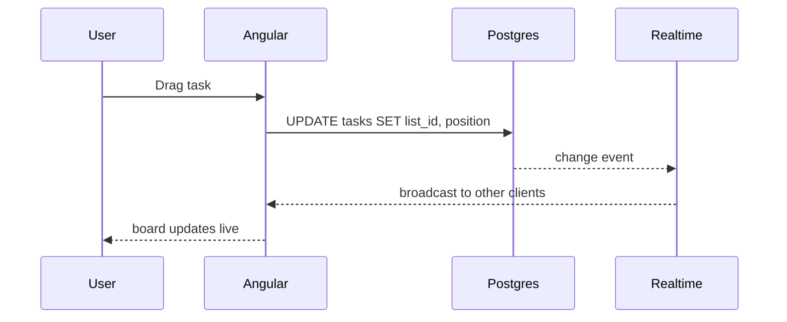

# Architecture — HatuaBoard

## 1. Overview

HatuaBoard is a single-page Angular application backed by Supabase
(Auth + Postgres + Realtime + Storage). It follows a **feature-first**
architecture with standalone components and signals for state.



## 2. Frontend architecture

- **Angular** with standalone components
- **Signals** for reactive state; services own the state
- **RxJS** only where it earns its place (HTTP, debounce, streams)
- **Lazy-loaded routes** per feature
- **Route guards** for auth and role checks
- **HTTP interceptor** for auth token + error handling

### Folder layout

```
src/
├── app/
│   ├── core/            # singleton: auth, guards, interceptors, layout
│   ├── shared/          # reusable UI + pipes + directives
│   ├── features/
│   │   ├── auth/
│   │   ├── workspaces/
│   │   ├── boards/
│   │   ├── tasks/
│   │   ├── dashboard/
│   │   └── settings/
│   ├── data/            # services, models, API clients
│   └── app.routes.ts
├── assets/
├── styles/
└── environments/
```

### State management

- Start with **Signals + services**.
- Introduce **NgRx SignalStore** only if a feature gets complex (e.g. board with realtime).
- No global store for v1.

## 3. Backend architecture (Supabase)

- **Auth**: email/password + Google OAuth
- **Postgres**: relational schema (see DATA-MODEL.md)
- **Row Level Security (RLS)**: every table scoped to workspace membership
- **Realtime**: Postgres changes broadcast to subscribed clients
- **Storage**: task attachments, avatars



## 4. Security

- RLS on all tables; users only touch their workspaces
- JWT from Supabase Auth attached by interceptor
- Role checks in guards + RLS policies
- No secrets in the frontend except the public anon key
- Signed URLs for file downloads

## 5. Performance

- Lazy routes + route-level code splitting
- `OnPush` change detection everywhere
- TrackBy in lists
- Virtual scroll for long boards (CDK)
- Image optimization + `loading="lazy"`
- Preconnect to Supabase domain
- Service worker caches shell + read-only data

## 6. Accessibility

- WCAG AA target
- Keyboard-navigable drag-and-drop (CDK a11y)
- Focus management on modals
- ARIA on interactive elements
- Color contrast checked

## 7. Observability

- Console errors surfaced to a toast in dev
- Optional Sentry in production
- Web Vitals captured in analytics

## 8. Deployment

See [DEPLOYMENT.md](./DEPLOYMENT.md).

## 9. Tradeoffs

| Decision | Why | Cost |
|---|---|---|
| Signals over NgRx | Simpler, less boilerplate | Less tooling for complex flows |
| Supabase over custom API | Faster to ship, realtime built-in | Vendor lock-in |
| SCSS + Material over Tailwind | Cohesive components | Larger bundle |
| PWA read-only offline | Low complexity | Writes require network |