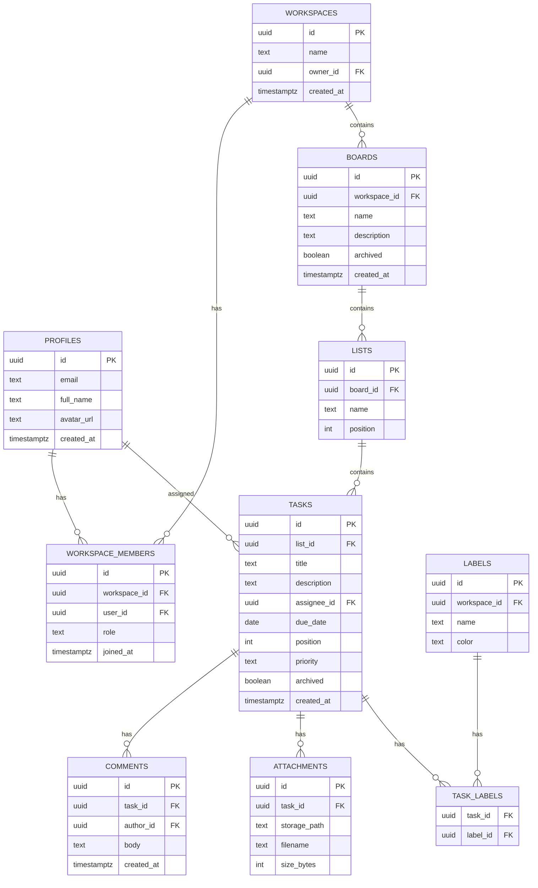

# Data Model — HatuaBoard

## 1. Entity Relationship Diagram



## 2. Tables

### profiles
Mirrors `auth.users`. Created via trigger on signup.

| Column | Type | Notes |
|---|---|---|
| id | uuid | PK, = auth.users.id |
| email | text | unique |
| full_name | text | |
| avatar_url | text | |
| created_at | timestamptz | default now() |

### workspaces
| Column | Type | Notes |
|---|---|---|
| id | uuid | PK |
| name | text | |
| owner_id | uuid | FK profiles.id |
| created_at | timestamptz | |

### workspace_members
| Column | Type | Notes |
|---|---|---|
| id | uuid | PK |
| workspace_id | uuid | FK workspaces.id |
| user_id | uuid | FK profiles.id |
| role | text | owner \| admin \| member \| viewer |
| joined_at | timestamptz | |

Unique: (workspace_id, user_id)

### boards
| Column | Type | Notes |
|---|---|---|
| id | uuid | PK |
| workspace_id | uuid | FK |
| name | text | |
| description | text | |
| archived | boolean | default false |
| created_at | timestamptz | |

### lists
| Column | Type | Notes |
|---|---|---|
| id | uuid | PK |
| board_id | uuid | FK |
| name | text | |
| position | int | ordering |

### tasks
| Column | Type | Notes |
|---|---|---|
| id | uuid | PK |
| list_id | uuid | FK |
| title | text | |
| description | text | |
| assignee_id | uuid | FK profiles.id, nullable |
| due_date | date | nullable |
| position | int | ordering within list |
| priority | text | low \| medium \| high \| urgent |
| archived | boolean | |
| created_at | timestamptz | |

### comments
| Column | Type | Notes |
|---|---|---|
| id | uuid | PK |
| task_id | uuid | FK |
| author_id | uuid | FK profiles.id |
| body | text | |
| created_at | timestamptz | |

### attachments
| Column | Type | Notes |
|---|---|---|
| id | uuid | PK |
| task_id | uuid | FK |
| storage_path | text | path in Supabase Storage |
| filename | text | |
| size_bytes | int | |

### labels
| Column | Type | Notes |
|---|---|---|
| id | uuid | PK |
| workspace_id | uuid | FK |
| name | text | |
| color | text | hex |

### task_labels
Join table. Composite PK (task_id, label_id).

## 3. Indexes

- `tasks(list_id, position)`
- `tasks(assignee_id)`
- `lists(board_id, position)`
- `boards(workspace_id)`
- `workspace_members(user_id)`
- `comments(task_id, created_at)`

## 4. Row Level Security policies

General rule: a user can access a row if they are a member of the
owning workspace.

Example — `tasks` read policy:

```sql
create policy "tasks readable by workspace members"
on tasks for select
using (
  exists (
    select 1 from lists l
    join boards b on b.id = l.board_id
    join workspace_members m on m.workspace_id = b.workspace_id
    where l.id = tasks.list_id and m.user_id = auth.uid()
  )
);
```

Write policies additionally check role != 'viewer'.

## 5. Realtime

Enable Postgres changes broadcast on:
- `tasks`
- `lists`
- `comments`

Filter subscriptions by `board_id` or `workspace_id` for efficiency.

## 6. Storage buckets

- `avatars` — public read, owner write
- `attachments` — private, signed URLs only

## 7. Migrations

Tracked in `supabase/migrations/` (SQL files, timestamped).