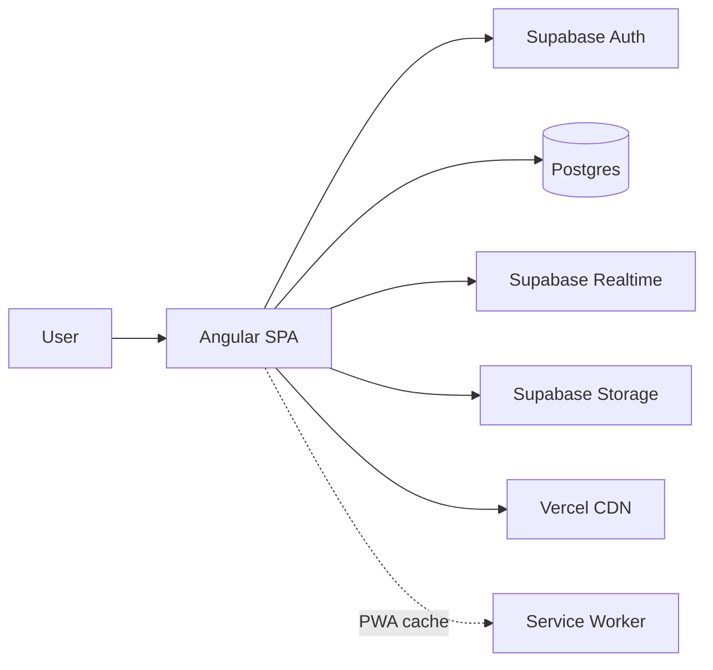
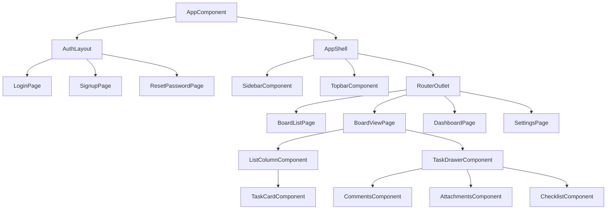
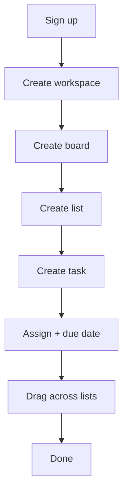
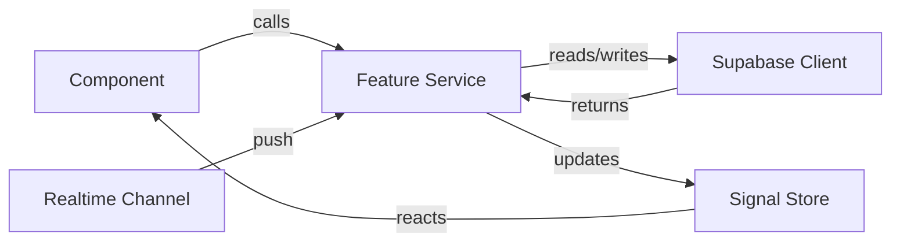
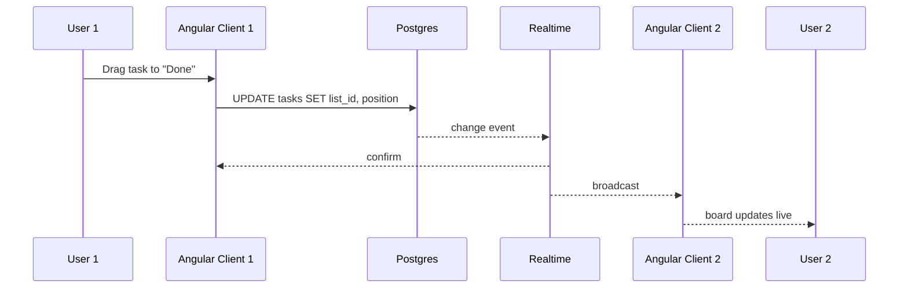
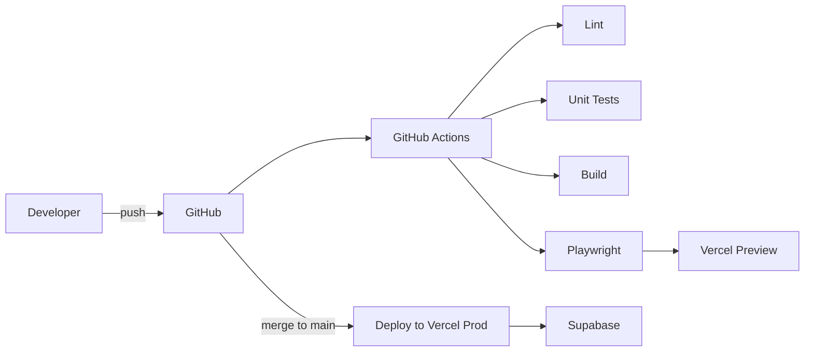

# Diagrams — HatuaBoard

All diagrams use Mermaid so they stay versioned with the code.
GitHub renders them automatically.

---

## 1. System Architecture

---

## 2. Component Tree

---

## 3. User Flow — First Task

---

## 4. State Flow (Signals)

---

## 5. Drag-and-Drop Realtime Sequence

---

## 6. CI/CD Pipeline

---

## 7. ERD (short form)

See [DATA-MODEL.md](./DATA-MODEL.md#1-entity-relationship-diagram) for the full ERD.

---

## 8. Wireframes

Wireframes live in `docs/diagrams/wireframes/` as exported images
from Figma or Excalidraw. Naming convention:

- `01-login.png`
- `02-signup.png`
- `03-app-shell.png`
- `04-board-view.png`
- `05-task-drawer.png`
- `06-dashboard.png`
- `07-settings.png`