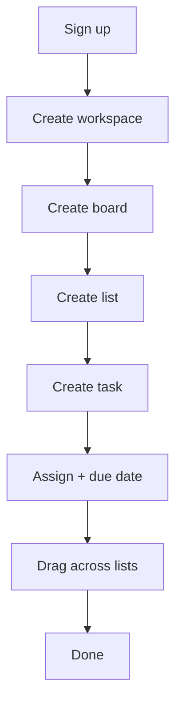
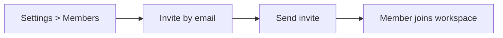

# UI / UX — HatuaBoard

## 1. Design principles

1. **Calm, not cluttered.** Whitespace is a feature.
2. **Hatua kwa hatua.** Progress is visible at every level.
3. **Warm, African-modern.** Earth tones with one bold accent.
4. **Fast on cheap phones.** Small bundles, no heavy animation.
5. **Accessible by default.** WCAG AA minimum.

## 2. Brand

- **Name:** HatuaBoard
- **Tagline:** Every step counts.
- **Secondary tagline:** Hatua kwa hatua, pamoja.

### Color palette

| Role | Hex | Notes |
|---|---|---|
| Primary | `#0B6E4F` | Deep Kenyan green |
| Primary-dark | `#084C37` | |
| Accent | `#F26B21` | Warm orange |
| Sand | `#F4EDE4` | Background |
| Charcoal | `#1C1C1C` | Text |
| Muted | `#6B7280` | Secondary text |
| Success | `#16A34A` | |
| Warning | `#F59E0B` | |
| Danger | `#DC2626` | |

Dark mode:
- Background `#0F1115`, surface `#171A21`, text `#E6E6E6`,
  primary stays green, accent stays orange.

### Typography

- **Headings:** Inter / Manrope
- **Body:** Inter
- **Mono:** JetBrains Mono (for IDs, code)

### Logo idea

A grid (board) with an upward path or three footsteps crossing it.

## 3. Information architecture

```
App
├── Auth
│   ├── Login
│   ├── Signup
│   └── Reset password
├── App shell (authenticated)
│   ├── Workspace switcher
│   ├── Board list
│   ├── Board view (Kanban)
│   ├── Task detail (drawer/modal)
│   ├── Dashboard
│   └── Settings
│       ├── Profile
│       ├── Workspace
│       └── Members
```

## 4. Key screens

### 4.1 Login / Signup
Centered card, logo, email + password, Google button, small link
to switch between login/signup. Sand background, green primary.

### 4.2 App shell
Left sidebar (workspaces + boards), top bar (search, user menu,
dark mode toggle), main content area.

### 4.3 Board view (Kanban)
Horizontal columns. Each column: header with title + count + menu,
then task cards. Task card shows title, labels, assignee avatar,
due date. Drag-and-drop via Angular CDK.

### 4.4 Task detail
Right-side drawer (desktop), full-screen sheet (mobile).
Sections: title, description, assignee, due date, labels,
checklist, comments, attachments, activity.

### 4.5 Dashboard
Cards: tasks completed, overdue, workload. Charts: line chart of
completion over time, bar chart of workload per member.

### 4.6 Settings
Tabs: Profile · Workspace · Members · Danger zone.

## 5. User flows

### Create a workspace and first task



### Invite a member



## 6. Components (shared)

- `hb-button` — primary, secondary, ghost, danger
- `hb-input` — text, password, textarea
- `hb-select`
- `hb-avatar` — image + initials fallback
- `hb-badge` / `hb-label-chip`
- `hb-card`
- `hb-modal` / `hb-drawer`
- `hb-toast`
- `hb-empty-state`
- `hb-skeleton`
- `hb-confirm-dialog`

## 7. States

Every data view must handle:
- **Loading** — skeleton, not spinner if possible
- **Empty** — friendly message + primary action
- **Error** — retry button, plain language
- **Offline** — banner: "You're offline. Changes will sync."

## 8. Responsive breakpoints

| Breakpoint | Layout |
|---|---|
| < 640px | Single column, drawer nav, sheets |
| 640–1024px | Collapsed sidebar |
| > 1024px | Full sidebar + board |

## 9. Accessibility

- Focus rings visible
- Drag-and-drop keyboard alternative (move menu)
- ARIA roles on board, list, task
- Color never the only signal
- Contrast ≥ 4.5:1

## 10. Motion

- 120–200ms transitions
- Respect `prefers-reduced-motion`
- No gratuitous animation